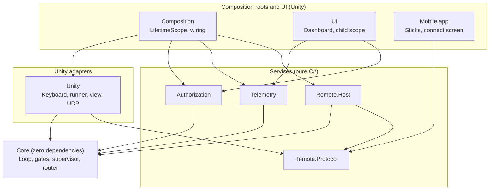
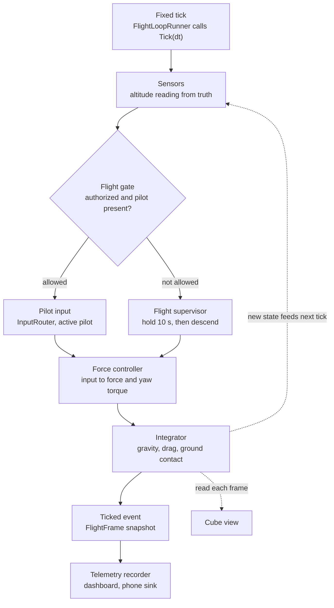
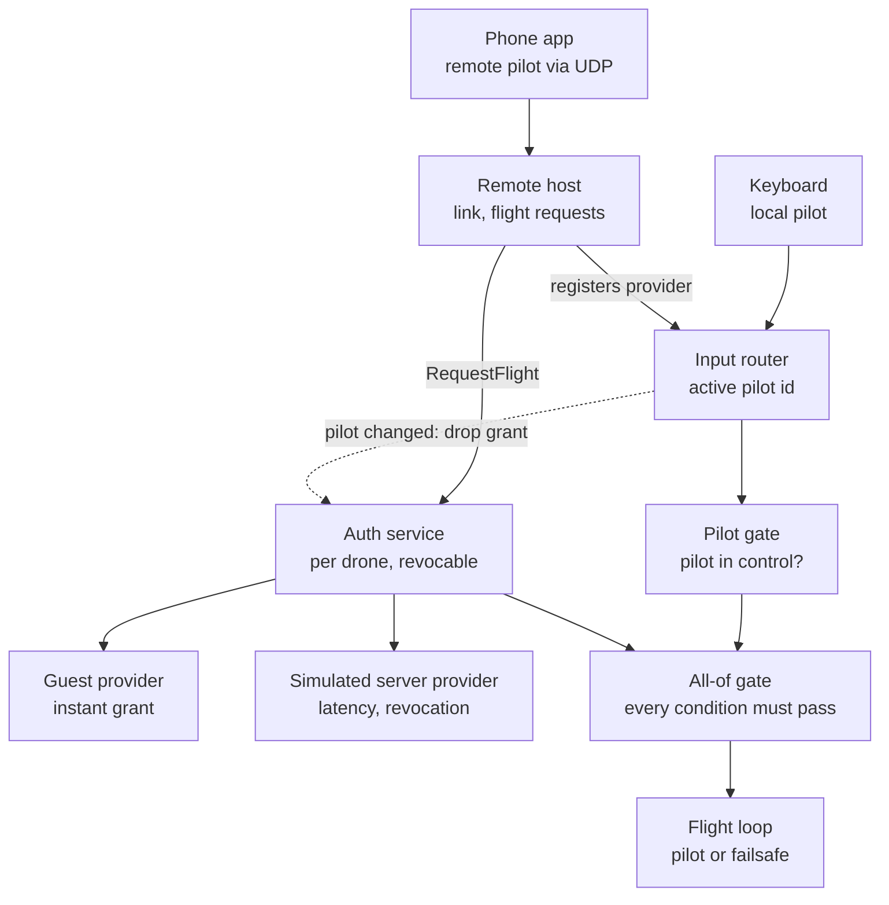

# Drone Flight Module — Architecture

A minimal prototype of a drone flight loop, built for frequently changing hardware, control
schemes and services. Visuals are a primitive cube in an empty scene; the focus is
extensibility, boundary separation and testability.

## Guiding rules

- **Core runs alone.** `DroneFlightModule.Core` has no `UnityEngine` reference
  (`noEngineReferences: true`) and no third-party dependencies. It integrates its own physics
  and runs headless.
- **References point inward only.** Outer layers depend on inner ones, never the reverse.
  Deleting the UI (or any outer assembly) never breaks flight logic.
- **Composition roots are the only place that knows concrete types.** Everything else takes
  its dependencies through plain constructors, with no `[Inject]` attributes outside
  MonoBehaviours.
- **Extend by adding, not editing.** A new input source, authorization provider, gate
  condition or telemetry sink is a new class plus one registration line in a composition root.

## Assembly layers

| Assembly | References | Purpose |
|---|---|---|
| `DroneFlightModule.Core` | nothing | Math, state, terrain, altitude sensor, input contract, router, gates, supervisor, controller, integrator, `FlightLoop` |
| `DroneFlightModule.Authorization` | Core | Per-drone authorization service, revocable grants, providers |
| `DroneFlightModule.Telemetry` | Core | Recorder sampling `FlightLoop.Ticked`, `ITelemetrySink` implementations |
| `DroneFlightModule.Remote.Protocol` | nothing | Messages, binary codec, `ITransport`, loopback transport |
| `DroneFlightModule.Remote.Host` | Core, Remote.Protocol | `RemoteInputProvider`, link-loss timeout, flight requests (network telemetry sink later) |
| `DroneFlightModule.Unity` | Core, Remote.Protocol, Input System | Keyboard provider, `FlightLoopRunner`, cube view, UDP transport |
| `DroneFlightModule.Composition` | Core, Unity, Authorization, Telemetry, Remote.Host, VContainer | Simulator `LifetimeScope` and installers |
| `DroneFlightModule.UI` | Core, Authorization, Telemetry, VContainer | Dashboard (IMGUI) in its own child scope |
| `*.Tests` (one per assembly) | Its target + NUnit | Edit-mode tests |

Nothing references `UI`. Its child scope pulls the recorder and authorization service from the
parent scope, so deleting the UI folder leaves only a missing-script warning.

## One fixed tick

- **Time** comes only from `Tick(dt)`. Unity calls it from VContainer's `IFixedTickable`
  (`Time.fixedDeltaTime`); tests and headless sims call it from a plain loop.
- **Input** is a `ControlInput`: local-frame move vector (X strafe, Y climb, Z forward) and yaw,
  each clamped to [-1, 1].
- **Force model:** the controller rotates the local move vector by the drone's yaw into a world
  force and maps yaw input to a torque about the vertical axis. There is no gravity
  compensation, so the drone must be pushed up.
- **Integration:** semi-implicit Euler over position, velocity, yaw and yaw rate, with gravity,
  linear and angular drag, and ground contact against `ITerrain`. Contact clamps height, cancels
  downward velocity and sets `DroneState.IsGrounded`.
- **Sensors** are sampled from the true state at the start of each tick. The reading goes into
  `FlightFrame`.
- **Observers** (telemetry, view) only read. They never feed back into the loop.

## Terrain and altitude sensor

Simulation truth and what the drone measures are kept apart. Physics reads the true ground
directly. Flight logic (supervisor, telemetry, dashboard) only sees sensor readings.

- **`ITerrain { float HeightAt(float x, float z) }`** is the only definition of where the ground
  is. The integrator and the sensor both query it, so they always agree. `FlatTerrain` (a
  constant height) is the first implementation. Uneven ground later, such as a heightmap or a
  Unity raycast adapter, is a new implementation with no changes to flight logic.
- **`DroneState.IsGrounded`** is a true contact flag set by the integrator, like a landing-gear
  switch. The supervisor uses it to detect touchdown.
- **`IAltitudeSensor { AltitudeReading Read(in DroneState truth, double time) }`**, where
  `AltitudeReading { Agl, IsValid, Timestamp }` and AGL means height above ground level.
- **`RangefinderAltitudeSensor`** measures height above the terrain directly below the drone.
  - It has a configurable max range (for example 10 m), above which the reading is invalid.
  - It has a configurable update rate, and between samples returns the last reading.
  - It has no noise. Noise can be added later as a decorator (`NoisyAltitudeSensor` wrapping any
    `IAltitudeSensor`) with a seeded random source, without changing the rangefinder.
- In Unity, the scene shows a plane primitive at the terrain height. It is a visual only.

## Flight modes

- `FlightSupervisor` (Core) owns the mode, the countdown and the hover/descent input.
- **Holding** hovers in place: a proportional controller targets zero vertical speed, and
  lateral and yaw input are zero. Pilot input is ignored.
- **Descending** uses the same controller with a target sink rate: about 1 m/s higher up,
  slowing as the measured altitude drops below a flare height (for example 2 m), so the drone
  touches down gently.
- **Invalid altitude reading** (out of range or failed): the drone keeps descending at a constant
  safe rate. Touchdown is still detected by the contact flag, so a broken sensor can't keep the
  drone in the air.
- **Touchdown:** when `IsGrounded` becomes true, the motors cut and the mode becomes Grounded.
- **Vertical speed** comes from the true velocity for now, as a placeholder until there is a
  velocity or IMU sensor.
- The countdown runs on **simulation time** (it decrements by `dt`), so it pauses with the
  simulation and tests can check it without waiting.
- If the gate closes while grounded, there is no countdown. The drone simply can't take off.
- Countdown length, sink rate and gain are config values. Config validation requires max
  thrust to exceed the drone's weight.
- `FlightFrame` carries the mode and the remaining countdown for telemetry and UI.

## Flight gate and authorization

**Core contracts**
- `IFlightGate { bool IsFlightAllowed { get; } }`. `FlightLoop` reads only this.
- `AllOfFlightGate` combines gates. Future conditions (battery, geofence, coordinator hold)
  are new gates added in the composition root.
- `PilotInControlGate` passes while the router has an active source with a pilot.
- `InputRouter.Register(id, provider, pilotId)`, `Activate(id)`, `ActivePilotId`,
  `ActiveChanged`. Reads zero input when nothing is active.

**Authorization assembly**
- `IAuthorizationProvider { string Id; Task<AuthorizationResult> AuthorizeAsync(AuthorizationRequest, CancellationToken) }`
- `AuthorizationRequest { DroneId, PilotId }`, so a future coordinator can decide per drone.
- A successful result carries an `AuthorizationGrant` whose `Revoked` token the provider can
  cancel at any time. The service watches it and closes the gate.
- `FlightAuthorizationService : IFlightGate, IDisposable`, one per drone, with states
  Unauthorized → Pending → Authorized / Denied.
  - A new request cancels the pending one, and stale results are ignored.
  - A pilot change drops the current grant.
  - `Dispose()` cancels anything in flight.
- **Providers:** `LocalGuestAuthorizationProvider` grants immediately.
  `SimulatedServerAuthorizationProvider` has configurable latency, an approve/deny policy and
  simulated revocation.
- **Guest mode is not a bypass.** It goes through `FlightAuthorizationService` like every other
  provider: same request (`DroneId`, `PilotId`), same states (Pending, then Authorized), and the
  same revocable grant. A pilot change drops a guest grant too. The only difference is that its
  `AuthorizeAsync` completes immediately. Nothing anywhere checks "is this guest mode?".
- **Adding a third provider** means a new class and one registration line. No flight code,
  service or existing provider changes.

**Toward a flight coordinator.** A coordinator is just another provider that receives
`AuthorizationRequest`s and decides per drone. The contracts above (`DroneId` in requests,
per-drone services, revocable grants) are the only preparation. The coordinator itself,
multiple drones in the scene and request queuing are out of scope for now.

## Async rules (plain `Task`, no UniTask)

UniTask's Unity package references `UnityEngine` and runs on Unity's PlayerLoop, so it would
break the Core boundary. All async code uses `Task` and `CancellationToken`.

- Every async API takes a `CancellationToken` and passes it all the way down.
- Services link requests to their own lifetime token, and `Dispose()` cancels it. VContainer
  disposes scoped services when the scope is destroyed.
- The composition root links `Application.exitCancellationToken`, because Tasks outlive play
  mode otherwise.
- MonoBehaviours pass `destroyCancellationToken` and don't touch `this` after an await without
  checking it.
- No `ConfigureAwait(false)` in Core or Authorization, so continuations return to Unity's main
  thread and events are handled there.
- No `async void` except at the Unity edge (input or button handlers). There it is wrapped in
  try/catch: cancellation is expected, anything else is logged.
- Latency comes from an injected delay (defaulting to `Task.Delay`), so tests control time.
- Socket receive loops never call Unity code. They write into a thread-safe latest-value slot
  that `FixedTick` reads.

## Telemetry and dashboard

- `TelemetryRecorder` subscribes to `FlightLoop.Ticked`, samples at a configurable rate, keeps
  the latest snapshot and a ring buffer, and forwards to `ITelemetrySink`s (in-memory first,
  network later).
- The dashboard (IMGUI) shows position, velocity, measured altitude (AGL, with the true height
  alongside for debugging), heading, the active input source,
  authorization state, flight mode and countdown. It only reads.
- **Deletion check:** delete the UI folder, confirm Unity compiles, the drone flies, and all
  remaining tests pass.

## Mobile remote control

- **Protocol** (shared, pure C#):
  - `Hello { PilotId, ProtocolVersion }`
  - `ControlPacket { Seq, Move, Yaw }` at about 30 Hz
  - `RequestFlight`
  - `TelemetryPacket` at about 10 Hz (reserved; added with telemetry to the phone later)
  - `Heartbeat`
  - A binary codec, and a version check during the handshake.
- **Transport:** `ITransport`, with a loopback version for tests and UDP (`System.Net.Sockets`)
  for real use. The handshake and `RequestFlight` are acknowledged and retried. Control packets
  use latest-wins, and out-of-order sequence numbers are dropped.
- **Host:** `RemoteInputProvider` is registered in the router under the phone's pilot id. With
  no packet for about 0.5 s it reports no pilot, which triggers the normal hold-then-descend
  failsafe.
- **App:** the same Unity project with a separate scene and a Build Profile each for iOS and
  Android, and its own small composition root. It ships without the flight-logic assemblies.
- **First version is controls only:** connect screen, sticks and a "Request flight" button.
  Telemetry to the phone comes later as a new sink and a readout, with no changes to Core or
  the existing telemetry code.
- **Platform notes:** iOS needs `NSLocalNetworkUsageDescription`, and Android needs `INTERNET`.
  The phone and the simulator must be on the same Wi-Fi.

## Testing strategy

- **Core:** unit tests for the controller, integrator, router, gates and supervisor. Also
  closed-loop tests driven by a scripted input provider and a plain `Tick` loop, for example
  "falls with no input", "descends after exactly 10 s", "switching pilot drops authorization".
- **Sensor and landing:** reading invalid above max range, reading held between samples, slow
  descent touches down below 0.3 m/s, sensor failure mid-descent still lands.
- **Authorization:** guest mode passes through the same states as other providers,
  controllable delay, cancellation mid-request, stale results ignored,
  revocation closes the gate, `Dispose()` cancels.
- **Telemetry:** sampling rate, ring buffer, sink fan-out.
- **Remote:** full loopback path from client to `FlightLoop`, including a link drop that leads
  to hold and then descent.
- **Device only:** the UDP transport and the touch UI.

## Commit plan

Each commit is small, logically separate and includes its own tests.

1. **Project setup:** Unity project, VContainer, assembly definitions, git root move, this
   document.
2. **Core flight model:** `Vec3`, `DroneState` (with `IsGrounded`), `DroneId`, `ControlInput`,
   `IInputProvider`, `DroneConfig`, `ITerrain` and `FlatTerrain`, force controller, integration
   with terrain contact, `FlightLoop` with `Ticked`.
3. **Altitude sensor:** `IAltitudeSensor`, `AltitudeReading`, `RangefinderAltitudeSensor` (max
   range, update rate, no noise), sampled each tick and carried in `FlightFrame`.
4. **Input routing:** `InputRouter` with pilot identity.
5. **Unity runtime:** keyboard provider, `FlightLoopRunner`, cube view, ground plane visual,
   `LifetimeScope`, scene.
6. **Gating and failsafe:** in Core, `IFlightGate`, `AllOfFlightGate`, `PilotInControlGate`
   and `FlightSupervisor` (hold, descent with flare from the altitude reading, fallback for an
   invalid reading, touchdown from the contact flag). The Authorization assembly with the
   service, revocable grant, and the guest and simulated server providers, both going through
   the service.
7. **Authorization in Unity:** keys to request authorization, switch provider and simulate
   revocation, with destroy and exit cancellation.
8. **Telemetry:** assembly, recorder, in-memory sink.
9. **Dashboard:** UI assembly, child scope, deletion check.
10. **Remote protocol:** messages, codec, `ITransport`, loopback.
11. **Remote host:** `RemoteInputProvider`, link-loss timeout, `RequestFlight`, end-to-end
    loopback test.
12. **UDP transport:** threading and cancellation, wired into the simulator scene.
13. **Mobile app:** scene, composition root, connect screen, sticks, iOS and Android Build
    Profiles.

Later: **telemetry to the phone** (network sink, `TelemetryPacket`, readout).

## Decisions

- **Mobile app:** a Unity build from this project.
- **Mobile platforms:** iOS and Android, both supported from the first version.
- **Phone telemetry:** not in the first version; controls only.
- **Altitude sensor:** a rangefinder only, measuring height above ground.
- **Sensor noise:** zero for now. Noise can be added later as a decorator.
- **Guest mode:** goes through the authorization service like any other provider.
