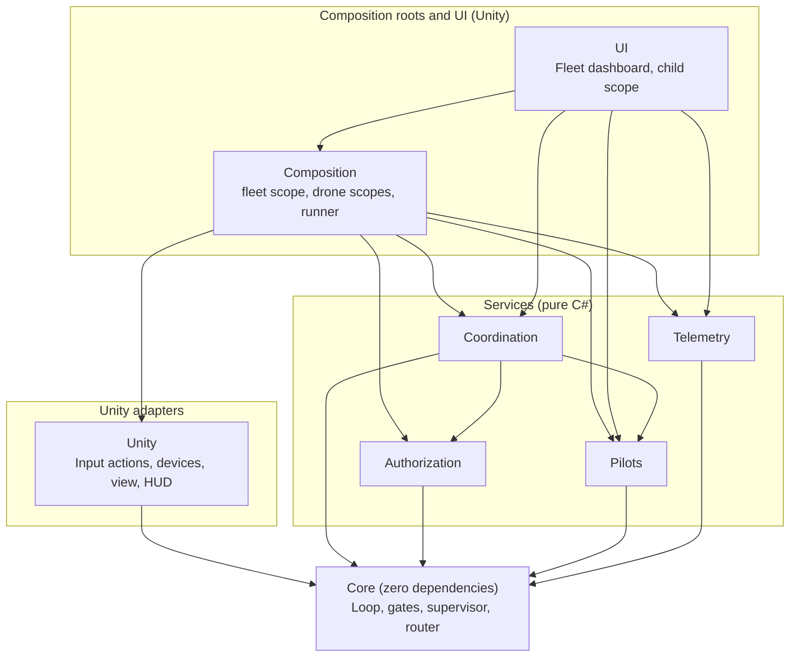
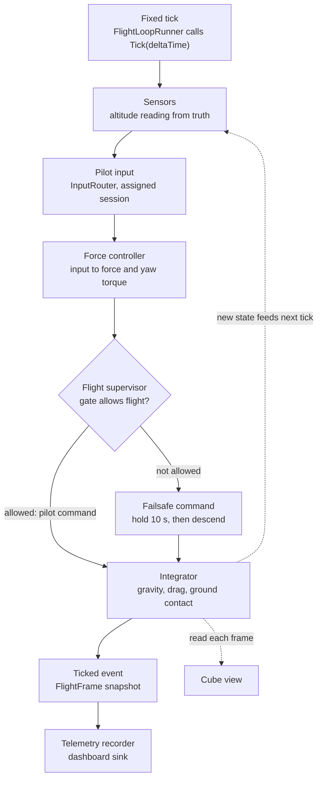
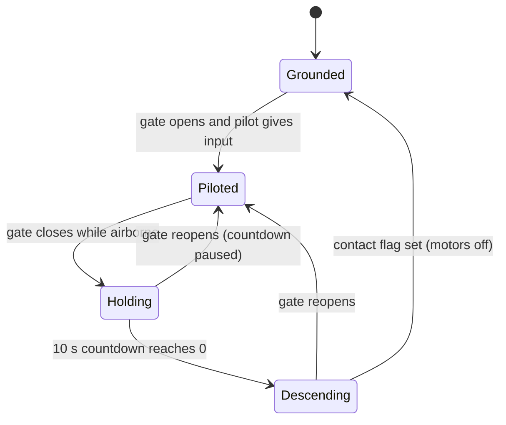
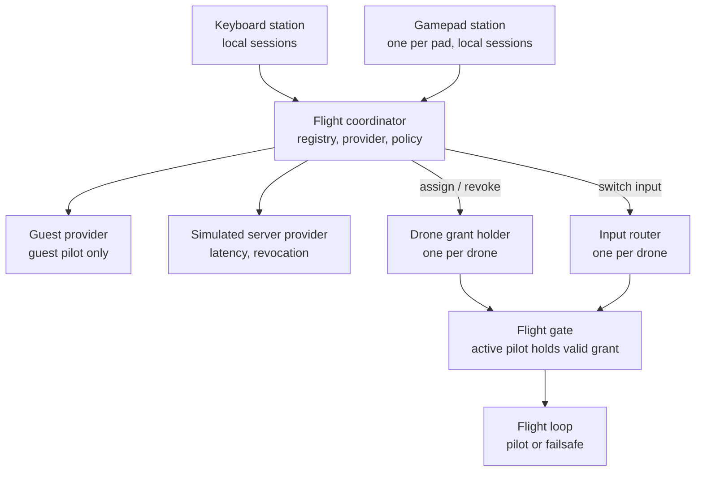

# Drone Flight Module — Architecture

A minimal prototype of a drone flight loop, built for frequently changing hardware, control
schemes and services. Visuals are primitive cubes in an empty scene; the focus is
extensibility, boundary separation and testability.

## Guiding rules

- **Core runs alone.** `DroneFlightModule.Core` has no `UnityEngine` reference
  (`noEngineReferences: true`) and no third-party dependencies. It integrates its own physics
  and runs headless.
- **References point inward only.** Outer layers depend on inner ones, never the reverse.
  Deleting the UI (or any outer assembly) never breaks flight logic.
- **Composition roots are the only place that knows concrete types.** Everything else takes
  its dependencies through plain constructors, with no `[Inject]` attributes outside
  MonoBehaviours.
- **Extend by adding, not editing.** A new input source, authorization provider, assignment
  policy, gate condition or telemetry sink is a new class plus one registration line in a
  composition root.

## Assembly layers

| Assembly | References | Purpose |
|---|---|---|
| `DroneFlightModule.Core` | nothing | Math, state, `DroneId`, `PilotId`, terrain, altitude sensor, input contract, router, gates, supervisor, controller, integrator, `FlightLoop` |
| `DroneFlightModule.Pilots` | Core | Pilot profiles and priorities, pilot registry, pilot stats |
| `DroneFlightModule.Authorization` | Core | Providers, revocable grants, per-drone grant holder and gate |
| `DroneFlightModule.Coordination` | Core, Pilots, Authorization | `FlightCoordinator`, pilot sessions, drone registry, assignment policy, stats recording |
| `DroneFlightModule.Telemetry` | Core | Recorder per drone sampling `FlightLoop.Ticked`, `ITelemetrySink` and the in-memory sink of the latest samples |
| `DroneFlightModule.Unity` | Core, Input System | Input-actions provider (keyboard and gamepad), smoothed drone view, debug HUD, follow camera, Core-to-Unity conversions |
| `DroneFlightModule.Composition` | everything except UI, plus VContainer and Input System | Fleet `LifetimeScope`, one child scope per drone, installers, the config assets and the `FleetSettings` they map to, a `PilotStation` per input device and the `InputDeviceStations` that makes them, `FleetKeys` (the fleet-wide keys), the `IFleetConsole` contract a control panel drives, `FlightLoopRunner` and `FleetRunner` (the only places Unity's clock reaches the simulation) |
| `DroneFlightModule.UI` | Core, Coordination, Pilots, Telemetry, Composition, VContainer, Input System | Fleet dashboard and control panel (IMGUI) in their own child scope |
| `DroneFlightModule.Editor` | Core, Unity, Composition, VContainer | Editor-only tools, such as the menu item that builds the prototype scene |
| `*.Tests` (one per assembly) | Its target + NUnit | Edit-mode tests, in `Tests/`; the UI's are in `UI/Tests` |

Nothing references `UI`. Its child scope pulls what it reads from the parent scope and its tests
sit inside its folder, so deleting that folder leaves only a missing-script warning.

## One fixed tick

Each drone has its own `FlightLoop`, ticked independently.

- **Time** comes only from `Tick(deltaTime)`. Unity calls it from VContainer's `IFixedTickable`
  (`Time.fixedDeltaTime`); tests and headless sims call it from a plain loop.
- **Input** is a `ControlInput`: local-frame move vector (X strafe, Y climb, Z forward) and yaw,
  each clamped to [-1, 1].
- **Controller:** `IFlightController` turns input into a force command. The scene uses
  `VelocityFlightController`: the sticks set target velocities in the drone's heading frame
  (up to 8 m/s across, 3 m/s climb and 1.5 rad/s yaw), and centred sticks hold position and
  altitude. Each axis is a proportional controller that cancels drag, and the vertical one also
  cancels weight; `HorizontalSpeedController` and `VerticalSpeedController` are shared with the
  failsafe. The loop tests use a raw force controller of their own, so the loop's physics stays
  visible there.
- **Controls** live in `DroneControls.inputactions`, not in code: WASD or the right stick to
  move, Space and Ctrl or the left stick's Y to climb and descend, Q and E or the left stick's X
  to yaw. `L` or Select cuts and restores a station's link, so the failsafe can be triggered
  on purpose. Each pilot station flies with its own copy of the asset, restricted to its
  device and destroyed with it, so enabling or disabling one station's actions never affects
  another. A disposed input provider reports its pilot as disconnected, so the failsafe takes
  over.
- **Debug view:** a follow camera keeps the drone in frame, and an IMGUI HUD lists the pilot
  stations and the controls. Each drone's mode, countdown, height and speed are on the fleet
  dashboard.
- **Integration:** semi-implicit Euler over position, velocity, yaw and yaw rate, with gravity,
  linear and angular drag, and ground contact against `ITerrain`. Contact clamps height, cancels
  downward velocity and sets `DroneState.IsGrounded`.
- **Sensors** are sampled from the true state at the start of each tick. The reading goes into
  `FlightFrame`.
- **Observers** (telemetry, view) only read. They never feed back into the loop.
- **The view is smoothed:** `DroneView` keeps the last two ticked states and blends between them
  by how far the frame is into the current fixed step, so it renders up to one tick behind the
  simulation without stutter. Smoothing lives only in the view; the simulation never sees it.

## Terrain and altitude sensor

Simulation truth and what the drone measures are kept apart. Physics reads the true ground
directly. Flight logic (supervisor, telemetry, dashboard) only sees sensor readings.

- **`ITerrain { float HeightAt(float x, float z) }`** is the only definition of where the ground
  is. The integrator and the sensor both query it, so they always agree. `FlatTerrain` (a
  constant height) is the first implementation. Uneven ground later, such as a heightmap or a
  Unity raycast adapter, is a new implementation with no changes to flight logic.
- **`DroneState.IsGrounded`** is a true contact flag set by the integrator, like a landing-gear
  switch. The supervisor uses it to detect touchdown.
- **`IAltitudeSensor { AltitudeReading Read(in DroneState truth, double time) }`**, where
  `AltitudeReading { HeightAboveGround, IsValid }`.
- **`RangefinderAltitudeSensor`** measures height above the terrain directly below the drone.
  - It is configured by a `RangefinderConfig`: a max range (10 m by default), above which the
    reading is invalid, and an update rate (20 Hz), between samples returning the last reading.
  - It has no noise. Noise can be added later as a decorator (`NoisyAltitudeSensor` wrapping any
    `IAltitudeSensor`) with a seeded random source, without changing the rangefinder.
- In Unity, the scene shows a plane primitive at the terrain height. It is a visual only.

## Flight modes

- `FlightSupervisor` (Core) owns the mode, the countdown and the hold/descent command. Each tick
  it takes the pilot's force command and either passes it on or replaces it with its own.
- **Holding** brakes to a stop and hovers: proportional controllers target zero horizontal and
  vertical speed, cancelling drag and weight, so the drone settles exactly; a drone that loses
  its link at 8 m/s stops within a few metres. Yaw torque is zero, since angular drag stops a
  spin and turning doesn't move the drone. Pilot input is ignored. Both controllers share one
  gain, `FailsafeConfig.SpeedGain`.
- **Descending** uses the same controllers, still braking drift, with a target sink rate: 1 m/s
  higher up, easing to 0.3 m/s as the measured altitude drops below the 2 m flare height, so the
  drone touches down gently.
- **Invalid altitude reading** (out of range or failed): the drone keeps descending at a constant
  safe rate of 0.5 m/s. Touchdown is still detected by the contact flag, so a broken sensor
  can't keep the drone in the air.
- **Touchdown:** when `IsGrounded` becomes true, the motors cut and the mode becomes Grounded.
- **Vertical speed** comes from the true velocity for now, as a placeholder until there is a
  velocity or IMU sensor.
- The countdown runs on **simulation time** (it decrements by `deltaTime`), so it pauses with the
  simulation and tests can check it without waiting.
- **Hold budget.** The countdown spends a budget of up to the hold duration. Flying earns it
  back at the same rate and landing refills it. A pilot who reconnects and flies on for the hold
  duration gets the full 10 s again, but a link that comes back for a moment resumes the hold
  where it left off, and during a descent it barely delays it. A flapping link can't keep the
  drone in the air.
- If the gate closes while grounded, there is no countdown. The drone simply can't take off.
- A takeover by a higher-priority pilot never closes the gate (see below), so it never starts
  the countdown.
- Hold duration, sink rates, flare height and gain are in `FailsafeConfig`. The supervisor
  rejects a drone whose max thrust doesn't exceed its weight, since it couldn't hold or descend
  slowly.
- `FlightFrame` carries the mode and the remaining countdown for telemetry and UI.

## Pilots

A small registry that defines who can fly and with what priority. Everything else asks it
instead of carrying pilot data around.

- **`PilotProfile { Id, DisplayName, Priority }`**. A higher number means higher priority.
- **`IPilotRegistry { Profiles; bool TryGet(PilotId, out PilotProfile) }`**, with
  `InMemoryPilotRegistry` built from a roster first. A file- or server-backed registry later is a
  new implementation. `Profiles` lists the highest priority first, for the dashboard.
- **The guest profile is built in** with priority 0, and registered pilots must have a higher
  one, so the guest is always strictly the lowest. It can't be registered or replaced, and it is
  used only by the local session (see authorization below).
- **Unknown pilots are denied** before any provider is asked.
- **`PilotStats { Flights, FlightTime, Takeovers, TimesPreempted, LastFlight }`**, kept in an
  `IPilotStatsStore` (in-memory first). The store only stores; `PilotStatsRecorder` decides what
  changes. `PilotStatsListener` (Coordination) calls it on the coordinator's events, timed by an
  `ISimulationClock`:
  - assigned: `FlightStarted(pilot, drone, time)`
  - released for any reason, including a switch: `FlightEnded(pilot, drone, time)`
  - takeover: `Preempted` and `FlightEnded` for the old pilot, `TookOver` and `FlightStarted` for
    the new one
- A pilot flies one drone at a time, so a switch ends one flight and starts the next. Flight
  time is accumulated in simulation time and counts finished flights only. Starting a flight
  that's already open, or ending one that isn't, throws: those are coordinator bugs.

## Flight gate and authorization

**Core contracts**
- `IFlightGate { bool IsFlightAllowed { get; } }`. `FlightSupervisor` reads only this, never
  why the gate is closed.
- `AllOfFlightGate` combines gates. Future conditions (battery, geofence) are new gates added
  in the composition root.
- `PilotInControlGate` passes while the router has an active input source that reports a
  connected pilot. An unplugged gamepad stops reporting one.
- `IInputProvider { bool IsConnected; ControlInput Read() }`. `IsConnected` is how a source
  reports whether its pilot can still reach it.
- `InputRouter`, one per drone, routes to the input provider of the session assigned to that
  drone. `Assign(pilotId, source)`, `Clear()` and `ActivePilotId`. It reads zero input when
  nothing is assigned or the source is disconnected.

**Authorization assembly**
- `IAuthorizationProvider { string Id; Task<AuthorizationResult>
  AuthorizeAsync(AuthorizationRequest, CancellationToken) }`. A provider answers one question: is
  this pilot allowed to fly at all?
- `AuthorizationRequest { PilotId }`.
- `AuthorizationResult` is either `Granted(grant)` or `Denied(reason)`.
- An `AuthorizationGrant { PilotId, ProviderId, Revoked }` is revoked by cancelling its
  `Revoked` token. Anyone holding it can check `IsRevoked` or register a callback.
- `GrantLedger` is shared by providers: at most one live grant per pilot, and a repeat request
  returns it. A request after a revocation gets a new grant.
- `IRevokingAuthorizationProvider : IAuthorizationProvider { bool Revoke(PilotId) }` is a
  provider that can take back a grant, as the simulated server does; a pilot station revokes
  through it, not through the concrete server.
- `DroneGrantHolder(InputRouter) : IFlightGate`, one per drone, holds the grant of the pilot
  assigned to that drone. It only gates; who flies which drone is the coordinator's record
  alone. It passes only while the grant is unrevoked and its `PilotId` matches the router's
  `ActivePilotId`, so a grant for one pilot never lets another pilot fly. Combined with
  `PilotInControlGate` through `AllOfFlightGate`, flight needs both a connected pilot and a valid
  grant.
- **Providers:**
  - `LocalGuestAuthorizationProvider` grants immediately (the task is already complete), but
    only to the guest pilot. Any other pilot is denied.
  - `SimulatedServerAuthorizationProvider` answers after an injected latency (`IDelay`, with
    `TaskDelay` for real time), approves or denies per pilot, and can
    `Revoke(pilot)` at any time. The policy is read when the answer arrives, so a change during
    the latency counts. `Approve` and `Deny` change only later answers; a denied pilot keeps a
    live grant until `Revoke`. It is not guest mode. Local pilots use it
    to sign in as a registered pilot.
  - Both cancel pending requests and revoke every grant on `Dispose()`; later requests fail with
    `ObjectDisposedException`. A null request throws synchronously from both.
  - An answer that arrives after `Dispose()` is cancelled instead of issuing a grant.
- **Guest mode is not a bypass.** It goes through the same coordinator pipeline, with the same
  request, the same revocable grant and the same gate as any other provider. The only
  difference is that its `AuthorizeAsync` completes immediately. Nothing checks "is this guest
  mode?".
- **Choosing a provider.** `IAuthorizationProviderSelector` decides who a pilot's provider is;
  `GuestOrServerSelector` sends the guest to guest mode and everyone else to the server. Stations
  only ask it, and revoke through whichever provider can.
- **Adding a third provider** means a new class, one registration line and the rule for who uses
  it in the selector. No flight code, coordinator, station or existing provider changes.

## Flight coordinator

One coordinator per simulator manages every drone and every pilot session. It decides which
drone a pilot gets, and whether that means taking a drone from someone else.

- **`PilotSession(PilotId, IAuthorizationProvider, IInputProvider)`** is created for a pilot at an
  input device. Input belongs to the pilot, not to the drone, so a session can be moved between
  drones without registering anything again.
- **`DroneRegistry`** holds the fleet as `FleetDrone(DroneId, InputRouter, DroneGrantHolder,
  IDroneStatus)`, in the order drones joined, which the policy also uses. Drones can join at any
  time, also while pilots fly; ids must be unique. They leave only through
  `FlightCoordinator.RemoveDrone`, which releases the drone first, so nobody is left flying a
  drone that is no longer in the fleet. `FlightLoopStatus` reads the
  status (grounded or not) straight from a drone's `FlightLoop`.
- **One pilot, one drone.** A pilot flies at most one drone, whichever session they use: a
  second session for the same pilot, say on a gamepad, moves their one drone or takes it over. The
  coordinator's assignments are the only record of it; grant holders only gate and the stats
  recorder only times flights.
- **`RequestFlightAsync(session, DroneId? preferred, CancellationToken)`** runs this pipeline:
  1. Look up the pilot's profile in the registry. Unknown pilots are denied, without asking a
     provider.
  2. Ask the session's provider to authorize the pilot.
  3. Ask the assignment policy for a decision, using a fresh snapshot of the fleet taken after
     authorization completes.
  4. Carry out the decision: assign, take over or deny.

  A session whose input is not connected once authorization completes is denied as
  `PilotDisconnected`, before step 3, so a drone never goes to a pilot who can't fly it and a
  takeover never closes the gate.
- A new request from the same session cancels its pending one, and so do `Release(session)`
  and `CancelRequest(session)`.
- **Two ways to ask who flies.** `TryGetDrone(pilot)` answers for the pilot, whichever session
  they use; `TryGetDrone(session)` answers for the exact session, and is what a station shows,
  so after a pilot moves to another device only the station that steers says it flies.
- **Results:** `Assigned { Drone }`, `TookOver { Drone, FromPilot }` or
  `Denied { Denial, Message }`. Denials are `UnknownPilot`, `NotAuthorized`, `PilotDisconnected`,
  `UnknownDrone` and `NoDroneAvailable`.
- **Switching drones.** A pilot who flies a drone and asks for another is given it like anyone
  else, and lets go of the first one only once the second is secured, in the same step. A
  denied request leaves them on the drone they fly. The released drone behaves as after any
  release: an airborne one holds, then lands. Asking for the drone they already fly, or for any
  drone, only routes it to the requesting session, for example when they pick up a gamepad; the
  flight goes on.
- **Events:** `Assigned`, `Released { Drone, Session, Pilot, Reason }`, `TookOver { Drone, Pilot,
  FromSession, FromPilot }`, `Moved { Drone, FromSession, Pilot }` (the same pilot's drone moved
  to another session; the flight goes on) and `Denied { Pilot, Preferred, Denial, Message }`. A
  cancelled request raises none. Release reasons are `Released`, `LinkLost`, `Revoked`, `Switched`
  and `Removed`. A takeover is not a release: the preempted pilot is `FromPilot`. Pilot stats,
  telemetry and the dashboard subscribe to them. Events are raised only once a change is complete,
  so a listener always sees the new state, and each listener is called on its own: one that throws
  is reported through `ListenerFailed`, which the composition logs, and can neither interrupt a
  switch nor reach whoever revoked a grant.

**`IAssignmentPolicy`**, first implementation `PriorityAssignmentPolicy`:
1. **A specific drone is requested:** assign it if it's free, take it over if its pilot ranks
   strictly lower, and otherwise deny with `NoDroneAvailable`. A drone that isn't in the fleet
   is `UnknownDrone`.
2. **Any drone is requested:** pick a free one, preferring grounded drones.
3. **No free drone:** find the drone whose pilot has the lowest priority. If the requesting
   pilot's priority is strictly higher, take that drone over.
4. **Otherwise deny** with `NoDroneAvailable`. Equal priority never takes over, and there is no
   queue for now.

The coordinator checks the decision before changing anything, so a faulty policy throws instead
of leaving a pilot half switched.

**Takeover hands control over directly:**
- The new grant is installed and the router switched to the new session in a single step on
  the main thread, between two ticks. The gate never sees a moment without a valid pilot, so the
  drone doesn't enter Holding and doesn't dip.
- The pilot who lost the drone is reported as `FromPilot` in the `TookOver` event.

**Releasing a drone:**
- The pilot releases it (a key, or a button in the control panel).
- The provider revokes the pilot's grant.
- The pilot switches to another drone.
- The drone leaves the fleet. A request still waiting for it is then denied as `UnknownDrone`.
- The drone has landed with no connected pilot (`ReleaseLandedWithoutPilot`, which
  `FleetRunner` calls every fixed tick), so a device that never comes back doesn't
  hold it forever.
- In every case the drone's grant and router are cleared. If it's airborne, the normal
  hold-then-descend failsafe follows. A link that drops in the air is not a release: the pilot
  gate closes and the failsafe holds until the link returns or the drone lands.

## Async rules (plain `Task`, no UniTask)

UniTask's Unity package references `UnityEngine` and runs on Unity's PlayerLoop, so it would
break the Core boundary. All async code uses `Task` and `CancellationToken`.

- Every async API takes a `CancellationToken` and passes it all the way down.
- Services link requests to their own lifetime token, and `Dispose()` cancels it. VContainer
  disposes scoped services when the scope is destroyed.
- The composition root links `Application.exitCancellationToken`, because Tasks outlive play
  mode otherwise.
- MonoBehaviours pass `destroyCancellationToken` and don't touch `this` after an await without
  checking it.
- No `ConfigureAwait(false)` in Core, Authorization or Coordination. Continuations return to
  Unity's main thread, which is what makes a takeover happen between two ticks.
- No `async void` except at the Unity edge (input or button handlers). There it is wrapped in
  try/catch: cancellation is expected, anything else is logged.
- Latency comes from an injected delay (defaulting to `Task.Delay`), so tests control time.

## Fleet in Unity

- **`FleetLifetimeScope`** is the scene's composition root. It reads its configuration from
  one `FleetSettingsAsset` (see "Config assets" below) and hands the mapped `FleetSettings` to
  `FleetInstaller`, which registers what the fleet shares: the frame, controller, rangefinder,
  failsafe and telemetry configs, the ground, the pilot registry (the guest plus the roster's
  pilots), stats, both providers, the coordinator, a fleet-wide
  `SimulationClock`, a pilot station per input device, the fleet-wide keys, the console and
  the drone instantiator. The
  installer is kept apart from the scope, so tests build the whole fleet without a scene, from
  `FleetSettings` they make themselves.
- **`DroneInstantiator`** adds and removes drones. Each drone gets its own child scope of the
  fleet's container: `DroneInstaller` registers that drone's loop, router, controller, sensor,
  supervisor, grant holder and the gate that combines them, and the instantiator adds a
  `FlightLoopRunner`. Shared objects come from the fleet scope. It also builds and binds the
  drone's view from the prefab, when there is one. A drone starts grounded if it spawns on the
  terrain under it. Each drone's loop starts at the fleet's simulation time, so a drone added
  later shares the timebase of those already flying and its telemetry lines up with theirs. The
  fleet scope only wires: it has the instantiator build the layout's drones (id and spawn
  position) from the drone prefab, and points the camera at the first. The scene holds no drones
  of its own. Being a plain class on the container, the instantiator is tested without a scene.
- **Joining the fleet.** The fleet starts empty, and each drone scope adds its `FleetDrone` to
  the `DroneRegistry` once built, at startup or later. A request decides on the fleet as it is
  once authorization completes, so a drone that joins meanwhile is part of the decision.
- **Adding drones at runtime.** `DroneInstantiator.AddDrone()` builds a drone from the drone
  prefab, one spawn step past the last drone, with the first free `drone-N` id, and creates its
  child scope like the configured ones. A taken id is refused before anything is built. The
  Debug/AddDrone key (N) calls it. The new drone is
  free, so any pilot can request it straight away.
- **Removing drones at runtime.** `DroneInstantiator.RemoveDrone(id)` has the coordinator
  remove the drone, which releases it first, so its pilot's flight ends and they're told.
  Then the drone's child scope is disposed and its view is removed. The
  Debug/RemoveDrone key (M) removes the newest drone, and the next added one goes one step past
  the last drone it added.
  Disposing the instantiator, with the fleet, disposes every drone scope and destroys their
  views.
- **Input belongs to a pilot station**, not to a drone: one station per input device (see
  "Input devices" below), each with its own copy of the controls, its device's input and a link
  that can be cut wrapping it.
- **`PilotStation`** owns its device's controls, input and keys, and is built by
  `PilotStationFactory`. It holds a session on that input for every pilot in the registry: the
  guest through local guest mode, everyone else through the simulated server (0.5 s latency by
  default). Each session gets its own `LocalPilotInput` over the station's device: only the
  selected pilot's reads it, and the others stay connected with their hands off, so a pilot you
  switch away from keeps their drone, hovering, and the next pilot can take it over. A cut link
  cuts them all. A pilot at a station, flying or parked, is told when they are preempted and by
  whom, when their drone is removed or released for lost link, and when they move to another
  device; the pilot who took the drone hears it from their own request. Switching away from a
  pilot cancels their pending request, so they are never handed a drone nobody steers. It keeps
  the latest outcome for the control panel. Requests never fault: a superseded or cancelled one
  ends quietly, and anything else is logged.
- **`StationKeys`** binds a station's Fleet map and its link toggle on the station's own
  controls; **`FleetKeys`** binds the fleet-wide Debug keys that add and remove drones, on the
  fleet's copy. Both use `ActionBindings`. The dashboard's Tab stays with the dashboard.
- **Keys** (keyboard, gamepad):
  - R, South: request any drone
  - 1–3, D-pad left, up and right: request `drone-1` to `drone-3`, by id
  - X, East: release
  - P, Start: switch to the next pilot (the previous one keeps their drone, hands off)
  - V, North: the server revokes the current pilot's grant
  - L, Select: cut or restore the station's link
  - N: add a drone (keyboard only, fleet-wide)
  - M: remove the newest drone (keyboard only, fleet-wide)
- **View:** each drone's cube follows its own loop; the HUD has a line per station and one box for
  the controls; `StationFollowCamera` checks each frame and follows the drone of the station the
  console has chosen. A station's full status shows in the control panel.
- **Lifetime:** pending requests use a token linked to the scope's `destroyCancellationToken`
  and `Application.exitCancellationToken`. Destroying the scope cancels them, then the
  container disposes the providers, controls and listeners.

## Telemetry and dashboard

- **`TelemetryRecorder`**, one per drone in its child scope, subscribes to `FlightLoop.Ticked`
  and samples the `FlightFrame`s at `TelemetryConfig.SampleRate` (10 Hz) of simulation time,
  starting with the first tick. The schedule advances by whole periods, so a tick step that
  doesn't divide the period still averages 10 Hz; `SampleSchedule` in Core does this for the
  recorder and the rangefinder alike. It passes each sample to its `ITelemetrySink`s; nothing on
  the tick allocates. History is a sink's job, added when
  something reads it.
- **Telemetry only reads.** A sink that throws is reported through `SinkFailed`, which the
  composition logs, and skipped for that sample, so a broken sink can't break a tick or starve
  the other sinks.
- **`ITelemetrySink { Write(sample); End(drone); }`.** `End` says a drone's stream finished:
  disposing a recorder, as happens when its drone is removed, ends it in every sink.
- **`InMemoryTelemetrySink`**, one for the fleet, keeps the latest sample of every drone still
  streaming. The dashboard reads it; any later sink is one more in each drone's list.
- The **fleet dashboard** (IMGUI, `FleetDashboard`), docked to the right of the screen, shows
  for each drone:
  - the assigned pilot and their priority
  - flight mode and countdown
  - measured height above ground (with the true height alongside for debugging)
  - position, velocity and heading

  It also shows each pilot with their drone and stats, and the latest coordinator events
  (`FleetEventLog`: assignments, releases and why, takeovers and denials, stamped with
  simulation time). It only reads: per-drone values come from the fleet's in-memory telemetry
  sink, the rest from the coordinator and the registries. The text is rebuilt four times a
  second, and the Debug/ToggleDashboard action (Tab) shows or hides it. It stops short of the
  bottom of the screen, where the control panel sits.
- **Its own child scope.** `DashboardLifetimeScope` registers only the event log and
  `FleetDashboardReadout`, which builds the text and is tested on its own. Everything else
  comes from the fleet scope, its parent, which the scene names in the scope's parent
  reference by type name. The scene builder finds the dashboard through Unity's `TypeCache`
  by name too, and adds it only when the UI assembly exists, so nothing outside the UI
  assembly refers to it. Its toggle action lives in the shared controls asset; with UI
  deleted it is simply never enabled.
- **The control panel** (`ControlPanel`), docked bottom right in the same child scope, offers
  everything the keys do: a station dropdown (one per input device; everything but adding and
  removing drones acts on the chosen station), a pilot dropdown (every registered pilot and the
  drone they fly; picking one switches to them), a drone dropdown (any drone or one of the fleet
  with who flies it, through `ControlPanelChoices`, which falls back to any drone when the chosen
  one leaves), a status line with the station, its current pilot, their takeovers and preemptions
  and the latest outcome, and Request, Release, Revoke grant, Cut/Restore link, Add drone and
  Remove drone. Its text is built a few times a second and at once after a click, the status sizes
  itself to fit, and the panel scrolls when it would not fit the screen. The dashboard reads the
  panel's height to stop above it. It drives the fleet only through `IFleetConsole`, a small
  contract in Composition, next to `FleetConsole`, which implements it on top of the pilot
  stations and the drone instantiator; the UI references Composition, never the other way, so the
  panel stays deletable with the rest of the UI.
- **Deletion check:** delete the UI folder, which holds the UI's tests too, confirm Unity
  compiles, the drones fly, and all remaining tests pass. The dashboard's GameObject is left with
  missing scripts, which Unity only warns about; rebuilding the scene drops it.

## Config assets

The values the scene runs with live in ScriptableObject assets in `Assets/DroneFlightModule/Config`,
so they can be tuned in the inspector without touching code. Core keeps its plain config types,
their validation and their `Default`s, and never sees Unity.

- **One asset per Core config**, in Composition: `DroneFrameAsset` (`DroneConfig`),
  `VelocityControllerAsset`, `RangefinderAsset`, `FailsafeAsset` and `TelemetryAsset`. Each holds
  only serialized fields, initialized from the Core defaults, and `ToConfig()` builds the Core type,
  whose constructor validates them, so an invalid value fails the same way in the scene as in
  code.
- **`PilotRosterAsset`** lists the registered pilots (id, name, priority) as `PilotProfile`s; the
  registry adds the guest and checks the roster as a whole. Every registered pilot signs in
  through the simulated server.
- **`SimulatedServerAsset`** holds the server's latency, and **`FleetLayoutAsset`** the ground
  height, the drones the fleet starts with and the step between drones added later.
- **`InputDevicesAsset`** lists the input devices that get a pilot station, as
  `InputDeviceGroup`s: an Input System layout (`Keyboard`, `Gamepad`) and the controls'
  binding group it flies with, in the order stations are made at start.
- **`FleetSettingsAsset`** points at one of each and maps them all to `FleetSettings`, a plain
  object `FleetInstaller` takes. The fleet scope has a single settings field. A missing part
  fails with its name instead of falling back to defaults, so the scene never runs on values it
  wasn't given.
- Tests and headless runs keep using the Core defaults; the tests check that new assets match
  them, that edits and invalid values reach the Core types, and that the shipped settings map
  to a valid fleet.

## Input devices

The fleet doesn't know where input comes from. A pilot connects through a session, and a
session flies with an `IInputProvider`; whether that is a keyboard, a gamepad or a later device
matters only to the composition root that built it.

- **One pilot station per input device.** `PilotStation` (Composition) has its own copy of the
  controls asset restricted to its device (`InputActionAsset.devices` and the device's binding
  group as the binding mask), its own cuttable link, its own sessions for every registered
  pilot and its own selected pilot. Stations never see each other. Two stations meet only in
  the coordinator, under its usual rules, so a gamepad pilot taking over the keyboard pilot's
  drone is an ordinary takeover.
- **`InputDeviceStations`** (Composition) creates a station for every device of a configured
  `InputDeviceGroup` (from `InputDevicesAsset`; the keyboard and gamepads by default) present at
  start, group by group, and for each one plugged in later (`InputSystem.onDeviceChange`). A
  device matches the first group whose layout its own layout is, or is based on, so a group for
  `Gamepad` takes every kind of gamepad; a device matching no group, like the mouse, gets no
  station. Each group's layout must be known to the Input System and its binding group must be one
  of the controls' control schemes, or the stations fail to start. Stations are named by group and
  number, such as `Keyboard 1` or `Gamepad 2`. A new station starts as the lowest-ranked pilot no
  other station flies as, or as the guest when every pilot is taken, so an unknown device is never
  the strongest pilot: the keyboard is the guest, the first pad Ace and the second John.
- **Unplugging is link loss.** A station's input reports its pilot as connected only while its
  device's controls resolve. The Input System drops a removed device from every asset's device
  list, which leaves the station's list empty, so no other pad can drive it. Unplugging a pad
  closes the pilot gate, so its drone holds and then lands, and the sessions stay.
- **Silent drops.** macOS sometimes drops a Bluetooth pad with no `Removed` event: the device stays
  in `InputSystem.devices` and simply stops updating, seen on a real Xbox pad, and an idle pad looks
  the same. So `SilentDeviceInputProvider` reports a device as disconnected once it has sent nothing
  for its group's `SilenceTimeout` (15 s for gamepads, zero and never for keyboards), and any input
  reconnects it. It only closes the gate, so the pilot keeps the drone: the failsafe holds and
  lands it, and a landed drone is released. A pilot who leaves the pad untouched that long sees the
  same thing, the price of catching a real drop; a false hold can be recovered and a missed drop
  flies on stale input. A station whose device is merely silent stays, because a live pad would
  raise no event to bring it back.
- **One pad, one station.** A physical pad is known by its layout and serial, not its device
  object. After a silent drop the old device stays listed, as a stale entry, and the pad connects
  as a second device, which takes over the stale entry's station, at start or when it connects.
- **Coming back.** While a gone device's pilots still hold a drone, its station waits. The same
  pad returning takes it back, whether as the same device object, which is what the Input System
  normally revives, or as a new one with the same serial. The flight resumes within the hold
  budget, with the same pilot and station name.
- **Removing a station.** `FleetRunner` calls `InputDeviceStations.RemoveUnattended` every fixed
  tick: a station whose device is gone and that holds no drone, flying or parked, is disposed and
  leaves the HUD and the console, whose chosen station falls back to the first. That frees its
  name and its pilot. A drone that lands with no link is released, so this follows.
- **Disposing** the fleet disposes every station, destroys their controls and stops watching
  devices.
- **Same pilot on two devices:** the coordinator's one-pilot-one-drone rule applies, so the
  latest request moves the pilot's drone to that device.
- **Station keys and fleet keys.** Each station binds the Flight and Fleet maps and its link
  toggle to its own device. Adding and removing drones and the dashboard are fleet-wide and stay
  on the keyboard. Gamepad bindings: sticks as today, South to request any drone, D-pad left, up
  and right for drones 1 to 3, East to release, Start to switch pilot, North to revoke the grant,
  Select to cut the link.
- **UI:** the HUD shows a line per station (`IStationStatus`: name, pilot, drone, link), the
  control panel adds a station dropdown and drives the chosen one, and the camera follows that
  station's drone.
- **A new device type** is a control scheme with its bindings in the controls asset and one
  more entry in `InputDevicesAsset`. No code changes at all.

## Testing strategy

- **Core:** unit tests for the controllers, integrator, router, gates and supervisor. Also
  closed-loop tests driven by a scripted input provider and a plain `Tick` loop, for example
  "falls with no input" and "descends after exactly 10 s".
- **Sensor and landing:**
  - the reading is invalid above max range
  - the reading is held between samples
  - a slow descent touches down below 0.3 m/s
  - a sensor failure mid-descent still lands
- **Pilots:** registry lookup, guest profile has the lowest priority, stats updated from
  coordinator events.
- **Authorization:**
  - guest mode authorizes only the guest
  - a grant for one pilot doesn't open the gate for another
  - revocation closes the gate
  - controllable delay, cancellation mid-request and `Dispose()`
- **Coordinator** (multi-drone, headless):
  - a free drone is assigned, and "any" prefers grounded drones
  - an unknown pilot is denied
  - equal priority is denied when no drone is free
  - a higher priority takes over, the gate stays open on every tick and the mode stays Piloted
  - a provider revocation releases the pilot's drone
  - a pilot who asks for another drone lets go of the first only once it's secured, and a
    denied switch keeps the current drone
  - drones join and leave at any time; removing a flown drone releases it first
  - a new request cancels the pending one
  - "any drone" while flying keeps the current drone
  - a second session for a pilot moves their one drone, says so, and only that session reports it
  - a pilot with no link is denied, also when it drops during authorization
  - a drone that landed with no connected pilot is released, an airborne one is not
  - a throwing listener is reported, can't interrupt a switch and can't reach a revoker
- **Config assets:** new assets matching the Core defaults, edits and invalid values reaching
  the Core types, a missing part named, and the shipped settings making a valid fleet.
- **Fleet** (the real container, two drone scopes, real key presses through the Input System
  test fixture): drones join the fleet in order, one added while the fleet is in use can be
  flown, a taken id is refused, removing the guest's drone releases it and tells them, free
  drones hold and land, number keys switch drones, signing in through the server, switching
  pilots keeping the previous pilot's drone and cancelling their pending request, a parked
  pilot's drone ignoring the keyboard, a
  takeover from the same keyboard counted for both pilots, a preempted pilot being told, revocation,
  link loss, stats on the fleet's simulation time, a drone added later sharing the fleet's
  timebase, telemetry from every drone reaching the
  fleet sink and ending with the drone, and disposal disabling the controls.
- **Drone instantiator:** prefab ids and spawn spots, refused ids, a late drone starting at the
  fleet's time, removal destroying views (also when another drone joined the registry directly),
  the row restarting, grounded at spawn following the terrain, a drone without a view when there
  is no prefab, and disposal destroying the views.
- **Dashboard:** the event log's wording, times and capacity, the readout's drones (free,
  flown, holding, out of range), pilots in priority order with stats, and newest-first events,
  all in invariant culture, Tab hiding and showing the dashboard, and the control panel's
  pilot and drone choices, labels that follow a takeover and each pilot's takeover and
  preemption record; the console itself is covered by the fleet tests.
- **Telemetry:** sampling rate on simulation time, also on a step that doesn't divide the
  period, the first tick sampled, sink fan-out, a failing sink reported
  without breaking the flight or other sinks, the stream ending on dispose, and the in-memory
  sink's latest samples.
- **Input devices** (the Input System test fixture adding and removing virtual gamepads):
  - the keyboard gets a station as the guest, the mouse none
  - a pad plugged in gets its own station as the next free pilot, and the guest once all are taken
  - the keyboard and a pad fly two drones at once, each moving only its own
  - two pads stay independent
  - unplugging a pad holds and then lands its drone, and plugging it back in resumes it
  - another pad never stands in for an unplugged one
  - a pad that comes back as a new device resumes its station, and a different pad doesn't
  - a stale entry of a pad is replaced when the pad connects, and shares its station at start
  - a silent pad counts as disconnected and any input restores it; a new pad gets the full timeout,
    and a keyboard never times out
  - a gone device loses its station once it holds no drone, not before, and the console falls back
  - the same pilot on two devices moves their one drone to the latest request
  - a pad pilot takes over the keyboard pilot's drone by priority, and the keyboard is told
  - each station cuts only its own link
  - a request from an unplugged pad is refused, and a drone it landed is freed
  - a new station starts as the lowest-ranked free pilot
  - stations report only their own sessions' drones, flying or parked
  - the station line, the console's no-station fallback, and the camera following the chosen station
  - only configured devices get stations, and an unknown layout or binding group is refused
  - the console chooses a station and acts for it
  - disposal ends every station and ignores new devices

## Commit plan

Each commit is small, logically separate and includes its own tests.

1. **Project setup:** Unity project, VContainer, assembly definitions, git root move, this
   document.
2. **Core flight model:** `Vec3`, `DroneState` (with `IsGrounded`), `DroneId`, `PilotId`,
   `ControlInput`, `IInputProvider`, `DroneConfig`, `ITerrain` and `FlatTerrain`, force
   controller, integration with terrain contact, `FlightLoop` with `Ticked`.
3. **Altitude sensor:** `IAltitudeSensor`, `AltitudeReading`, `RangefinderAltitudeSensor` (max
   range, update rate, no noise), sampled each tick and carried in `FlightFrame`.
4. **Input routing:** `InputRouter` with pilot identity and connected-pilot reporting.
5. **Unity runtime:** keyboard provider (WASD move, Space climb, Q/E yaw), `FlightLoopRunner`,
   smoothed cube view, ground plane visual, editor menu that builds the scene,
   `LifetimeScope`, scene. One drone, flying without a gate.
6. **Gating and failsafe:** `IFlightGate`, `AllOfFlightGate`, `PilotInControlGate` and
   `FlightSupervisor` (hold, descent with flare from the altitude reading, fallback for an
   invalid reading, touchdown from the contact flag).
7. **Flight feel and project cleanup:** `VelocityFlightController` with the shared
   `VerticalSpeedController`, Input System actions asset (keyboard and gamepad) replacing the
   hard-coded keyboard provider, link-loss debug toggle, debug HUD, follow camera, README,
   template scene and unused packages removed.
8. **Pilots:** `PilotProfile`, `IPilotRegistry` and in-memory registry, built-in guest profile,
   `PilotStats` and stats store.
9. **Authorization:** providers (guest mode, simulated server with injected latency),
   revocable grants through `GrantLedger`, `DroneGrantHolder` gate.
10. **Flight coordinator:** `PilotSession`, drone registry, request pipeline,
    `IAssignmentPolicy` and `PriorityAssignmentPolicy`, direct takeover, release, events and
    stats recording.
11. **Fleet in Unity:** fleet scope and one child scope per drone, 2–3 cubes, keyboard session,
    keys, destroy and exit cancellation.
12. **Telemetry:** assembly, recorder per drone, in-memory sink.
13. **Dashboard:** UI assembly, child scope, fleet view, deletion check.
14. **Config assets:** ScriptableObjects in Composition for drone frame, velocity controller,
    rangefinder (with a new Core `RangefinderConfig`), failsafe, telemetry, pilot roster,
    simulated server latency and fleet layout, bundled by `FleetSettingsAsset` into the plain
    `FleetSettings` the installer takes. The scene builds its drones from the layout and the
    prefab. Tests check the mapping and that the shipped assets make a valid fleet.
15. **Gamepad pilots:** `PilotStation` per input device, `InputDeviceStations` watching device
    changes, unplugging as link loss, the remaining gamepad bindings, a station box in the HUD
    and a station dropdown in the control panel, tests with virtual gamepads.

## Decisions

- **Second input:** gamepads, each its own pilot station on the simulator machine, in place of a
  phone remote. There is no network remote.
- **Altitude sensor:** a rangefinder only, measuring height above ground.
- **Sensor noise:** zero for now. Noise can be added later as a decorator.
- **Guest mode:** authorizes only the guest pilot, from any device. It goes through the same
  pipeline as any other provider. The simulated server is not guest mode.
- **Flight coordinator:** handles multiple drones, takeovers by higher-priority pilots and
  handovers without triggering the failsafe.
- **Pilot data:** a pilot registry defines profiles and priorities and tracks stats. Priority
  comes from the registry, not from providers.
- **Equal priority with no free drone:** denied. There is no queue for now.
- **Takeover:** control is handed over instantly, even mid-flight. The drone doesn't need to
  land or hold first.
- **Config values:** ScriptableObject assets in Composition for the scene, mapped to the plain
  Core types; the Core defaults (such as `DroneConfig.Default`) stay for tests and headless runs,
  and the assets start from them.
