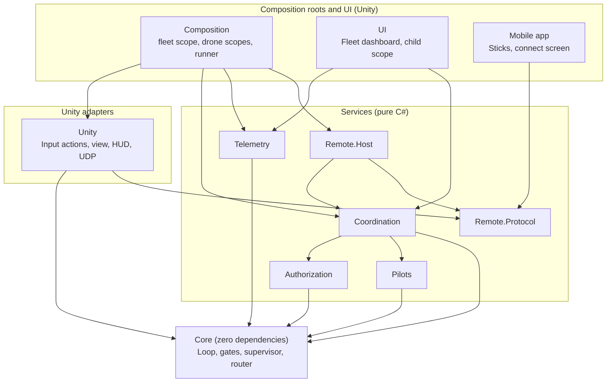
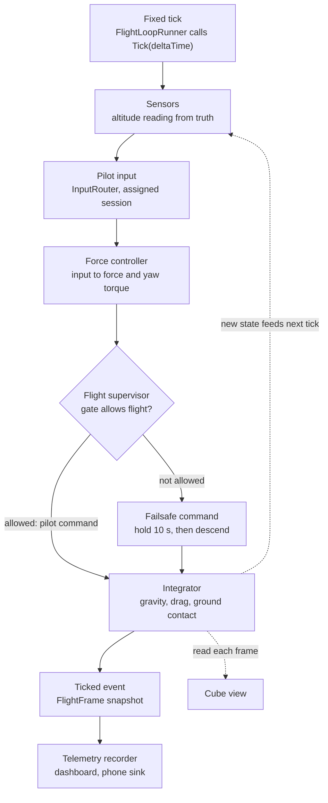
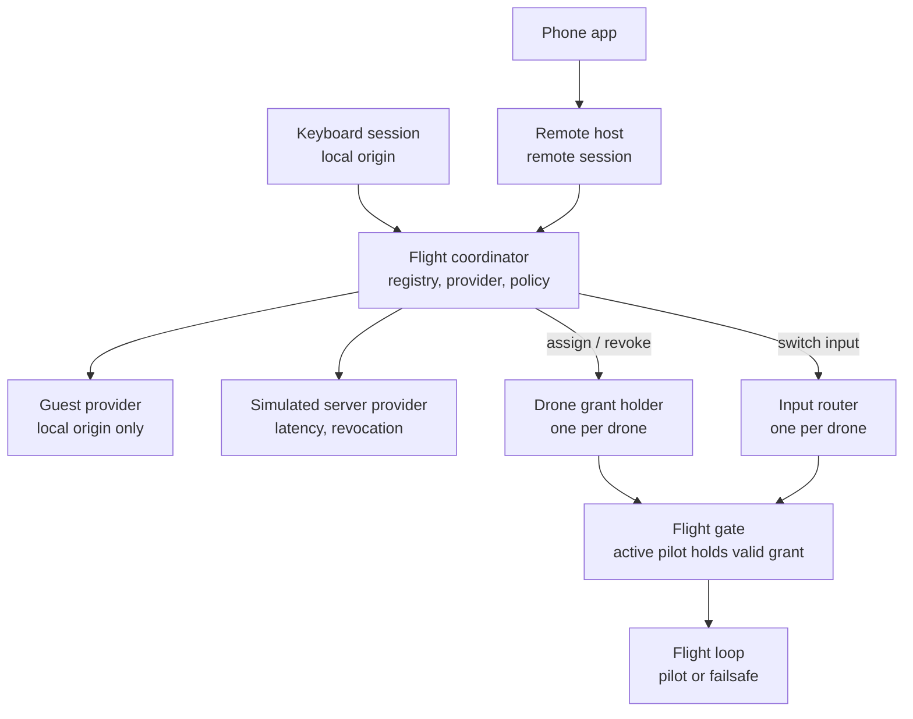

# Drone Flight Module — Architecture

A minimal prototype of a drone flight loop, built for frequently changing hardware, control
schemes and services. Visuals are primitive cubes in an empty scene; the focus is
extensibility, boundary separation and testability.

## Guiding rules

- **Core runs alone.** `DroneFlightModule.Core` has no `UnityEngine` reference
  (`noEngineReferences: true`) and no third-party dependencies. It integrates its own physics
  and runs headless.
- **References point inward only.** Outer layers depend on inner ones, never the reverse.
  Deleting the UI (or any outer assembly) never breaks flight logic.
- **Composition roots are the only place that knows concrete types.** Everything else takes
  its dependencies through plain constructors, with no `[Inject]` attributes outside
  MonoBehaviours.
- **Extend by adding, not editing.** A new input source, authorization provider, assignment
  policy, gate condition or telemetry sink is a new class plus one registration line in a
  composition root.

## Assembly layers

| Assembly | References | Purpose |
|---|---|---|
| `DroneFlightModule.Core` | nothing | Math, state, `DroneId`, `PilotId`, terrain, altitude sensor, input contract, router, gates, supervisor, controller, integrator, `FlightLoop` |
| `DroneFlightModule.Pilots` | Core | Pilot profiles and priorities, pilot registry, pilot stats |
| `DroneFlightModule.Authorization` | Core | Providers, revocable grants, per-drone grant holder and gate |
| `DroneFlightModule.Coordination` | Core, Pilots, Authorization | `FlightCoordinator`, pilot sessions, drone registry, assignment policy, stats recording |
| `DroneFlightModule.Telemetry` | Core | Recorder sampling `FlightLoop.Ticked`, `ITelemetrySink` implementations |
| `DroneFlightModule.Remote.Protocol` | nothing | Messages, binary codec, `ITransport`, loopback transport |
| `DroneFlightModule.Remote.Host` | Core, Coordination, Remote.Protocol | Remote pilot sessions, `RemoteInputProvider`, link-loss timeout (network telemetry sink later) |
| `DroneFlightModule.Unity` | Core, Remote.Protocol, Input System | Input-actions provider (keyboard and gamepad), link-loss debug toggle, smoothed drone view, debug HUD, follow camera, Core-to-Unity conversions, UDP transport |
| `DroneFlightModule.Composition` | everything except UI, plus VContainer and Input System | Fleet `LifetimeScope`, one child scope per drone, installers, `FlightLoopRunner` (the only VContainer-facing adapter) |
| `DroneFlightModule.UI` | Core, Coordination, Pilots, Telemetry, VContainer | Fleet dashboard (IMGUI) in its own child scope |
| `DroneFlightModule.Editor` | Core, Unity, Composition, VContainer | Editor-only tools, such as the menu item that builds the prototype scene |
| `*.Tests` (one per assembly) | Its target + NUnit | Edit-mode tests |

Nothing references `UI`. Its child scope pulls what it reads from the parent scope, so
deleting the UI folder leaves only a missing-script warning.

## One fixed tick

Each drone has its own `FlightLoop`, ticked independently.

- **Time** comes only from `Tick(deltaTime)`. Unity calls it from VContainer's `IFixedTickable`
  (`Time.fixedDeltaTime`); tests and headless sims call it from a plain loop.
- **Input** is a `ControlInput`: local-frame move vector (X strafe, Y climb, Z forward) and yaw,
  each clamped to [-1, 1].
- **Controller:** `IFlightController` turns input into a force command. The scene uses
  `VelocityFlightController`: the sticks set target velocities in the drone's heading frame
  (up to 8 m/s across, 3 m/s climb and 1.5 rad/s yaw), and centred sticks hold position and
  altitude. Each axis is a proportional controller that cancels drag, and the vertical one also
  cancels weight; `VerticalSpeedController` is shared with the failsafe. The simpler
  `ForceFlightController` (input scales force directly, no gravity compensation) is kept as a
  second implementation.
- **Controls** live in `DroneControls.inputactions`, not in code: WASD or the right stick to
  move, Space and Ctrl or the left stick's Y to climb and descend, Q and E or the left stick's X
  to yaw. `L` or Select cuts and restores the local pilot's link, so the failsafe can be
  triggered on purpose.
- **Debug view:** a follow camera keeps the drone in frame, and an IMGUI readout shows the mode,
  hold countdown, pilot link, measured height, speed and heading.
- **Integration:** semi-implicit Euler over position, velocity, yaw and yaw rate, with gravity,
  linear and angular drag, and ground contact against `ITerrain`. Contact clamps height, cancels
  downward velocity and sets `DroneState.IsGrounded`.
- **Sensors** are sampled from the true state at the start of each tick. The reading goes into
  `FlightFrame`.
- **Observers** (telemetry, view) only read. They never feed back into the loop.
- **The view is smoothed:** `DroneView` keeps the last two ticked states and blends between them
  by how far the frame is into the current fixed step, so it renders up to one tick behind the
  simulation without stutter. Smoothing lives only in the view; the simulation never sees it.

## Terrain and altitude sensor

Simulation truth and what the drone measures are kept apart. Physics reads the true ground
directly. Flight logic (supervisor, telemetry, dashboard) only sees sensor readings.

- **`ITerrain { float HeightAt(float x, float z) }`** is the only definition of where the ground
  is. The integrator and the sensor both query it, so they always agree. `FlatTerrain` (a
  constant height) is the first implementation. Uneven ground later, such as a heightmap or a
  Unity raycast adapter, is a new implementation with no changes to flight logic.
- **`DroneState.IsGrounded`** is a true contact flag set by the integrator, like a landing-gear
  switch. The supervisor uses it to detect touchdown.
- **`IAltitudeSensor { AltitudeReading Read(in DroneState truth, double time) }`**, where
  `AltitudeReading { HeightAboveGround, IsValid, Timestamp }`.
- **`RangefinderAltitudeSensor`** measures height above the terrain directly below the drone.
  - It has a configurable max range (for example 10 m), above which the reading is invalid.
  - It has a configurable update rate, and between samples returns the last reading.
  - It has no noise. Noise can be added later as a decorator (`NoisyAltitudeSensor` wrapping any
    `IAltitudeSensor`) with a seeded random source, without changing the rangefinder.
- In Unity, the scene shows a plane primitive at the terrain height. It is a visual only.

## Flight modes

- `FlightSupervisor` (Core) owns the mode, the countdown and the hold/descent command. Each tick
  it takes the pilot's force command and either passes it on or replaces it with its own.
- **Holding** hovers in place: a proportional controller targets zero vertical speed, and
  lateral force and yaw torque are zero, so drag brings any drift to rest. Pilot input is
  ignored. The controller also cancels weight and vertical drag, so the drone settles exactly on
  the target speed.
- **Descending** uses the same controller with a target sink rate: 1 m/s higher up, easing to
  0.3 m/s as the measured altitude drops below the 2 m flare height, so the drone touches down
  gently.
- **Invalid altitude reading** (out of range or failed): the drone keeps descending at a constant
  safe rate of 0.5 m/s. Touchdown is still detected by the contact flag, so a broken sensor
  can't keep the drone in the air.
- **Touchdown:** when `IsGrounded` becomes true, the motors cut and the mode becomes Grounded.
- **Vertical speed** comes from the true velocity for now, as a placeholder until there is a
  velocity or IMU sensor.
- The countdown runs on **simulation time** (it decrements by `deltaTime`), so it pauses with the
  simulation and tests can check it without waiting.
- If the gate closes while grounded, there is no countdown. The drone simply can't take off.
- A takeover by a higher-priority pilot never closes the gate (see below), so it never starts
  the countdown.
- Hold duration, sink rates, flare height and gain are in `FailsafeConfig`. The supervisor
  rejects a drone whose max thrust doesn't exceed its weight, since it couldn't hold or descend
  slowly.
- `FlightFrame` carries the mode and the remaining countdown for telemetry and UI.

## Pilots

A small registry that defines who can fly and with what priority. Everything else asks it
instead of carrying pilot data around.

- **`PilotProfile { PilotId, DisplayName, Priority }`**. A higher number means higher priority.
- **`IPilotRegistry { bool TryGet(PilotId, out PilotProfile) }`**, with `InMemoryPilotRegistry`
  loaded from config first. A file- or server-backed registry later is a new implementation.
- **The guest profile is built in** and always has the lowest priority. It is used only by the
  local keyboard session (see authorization below).
- **Unknown pilots are denied** before any provider is asked.
- **`PilotStats { Flights, FlightTime, Takeovers, TimesPreempted, LastFlight }`**, kept in an
  `IPilotStatsStore` (in-memory first). The coordinator's events update it: assigned, released,
  took over, preempted. Flight time is accumulated in simulation time.

## Flight gate and authorization

**Core contracts**
- `IFlightGate { bool IsFlightAllowed { get; } }`. `FlightSupervisor` reads only this, never
  why the gate is closed.
- `AllOfFlightGate` combines gates. Future conditions (battery, geofence) are new gates added
  in the composition root. Until the grant holder exists, the installer registers
  `PilotInControlGate` on its own.
- `PilotInControlGate` passes while the router has an active input source that reports a
  connected pilot. A phone whose link drops stops reporting one.
- `IInputProvider { bool IsConnected; ControlInput Read() }`. `IsConnected` is how a source
  reports whether its pilot can still reach it.
- `InputRouter`, one per drone, routes to the input provider of the session assigned to that
  drone. `Assign(pilotId, source)`, `Clear()`, `ActivePilotId` and `ActiveChanged`. It reads
  zero input when nothing is assigned or the source is disconnected.

**Authorization assembly**
- `IAuthorizationProvider { string Id; Task<AuthorizationResult> AuthorizeAsync(AuthorizationRequest, CancellationToken) }`.
  A provider answers one question: is this pilot allowed to fly at all?
- `AuthorizationRequest { PilotId, Origin }`, where `Origin` is `Local` or `Remote`.
- A successful result carries an `AuthorizationGrant { PilotId, Revoked }`. The provider can
  cancel the `Revoked` token at any time.
- `DroneGrantHolder : IFlightGate`, one per drone, holds the grant of the pilot assigned to that
  drone. It passes only while the grant is valid and its `PilotId` matches the router's
  `ActivePilotId`, so a grant for one pilot never lets another pilot fly.
- **Providers:**
  - `LocalGuestAuthorizationProvider` grants immediately, but only for `Origin.Local`. Any
    remote request is denied. Guest mode is reserved for the local machine and keyboard.
  - `SimulatedServerAuthorizationProvider` has configurable latency, an approve/deny policy per
    pilot and simulated revocation. It is not guest mode. Phones always use it, and the local
    keyboard can use it to sign in as a registered pilot.
- **Guest mode is not a bypass.** It goes through the same coordinator pipeline, with the same
  request, the same revocable grant and the same gate as any other provider. The only
  difference is that its `AuthorizeAsync` completes immediately. Nothing checks "is this guest
  mode?"; the origin rule is the guest provider's own decision.
- **Adding a third provider** means a new class and one registration line. No flight code,
  coordinator or existing provider changes.

## Flight coordinator

One coordinator per simulator manages every drone and every pilot session. It decides which
drone a pilot gets, and whether that means taking a drone from someone else.

- **`PilotSession { PilotId, Origin, ProviderId, IInputProvider }`** is created when a pilot
  connects (keyboard or phone). Input belongs to the pilot, not to the drone, so a session can
  be moved between drones without registering anything again.
- **Drone registry:** each drone's id, its grant holder, its router and a read-only view of its
  state (grounded, mode).
- **`RequestFlightAsync(session, DroneId? preferred, CancellationToken)`** runs this pipeline:
  1. Look up the pilot's profile in the registry. Unknown pilots are denied.
  2. Ask the session's provider to authorize the pilot.
  3. Ask the assignment policy for a decision, using a fresh snapshot of the fleet taken after
     authorization completes.
  4. Carry out the decision: assign, take over or deny.
- A new request from the same session cancels its pending one.
- **Results:** `Assigned { DroneId }`, `TookOver { DroneId, FromPilot }` or
  `Denied { Reason }`. Reasons include `UnknownPilot`, `NotAuthorized` and `NoDroneAvailable`.
- **Events:** `Assigned`, `Released`, `TookOver` and `Preempted`. Pilot stats, telemetry, the
  dashboard and the remote host subscribe to them.

**`IAssignmentPolicy`**, first implementation `PriorityAssignmentPolicy`:
1. **A specific drone is requested and it's free:** assign it.
2. **Any drone is requested:** pick a free one, preferring grounded drones.
3. **No free drone:** find the drone whose holder has the lowest priority. If the requesting
   pilot's priority is strictly higher, take that drone over.
4. **Otherwise deny** with `NoDroneAvailable`. Equal priority never takes over, and there is no
   queue for now.

**Takeover hands control over directly:**
- The new grant is installed and the router switched to the new session in a single step on
  the main thread, between two ticks. The gate never sees a moment without a valid pilot, so the
  drone doesn't enter Holding and doesn't dip.
- The pilot who lost the drone gets `Preempted { DroneId, ByPilot }`.

**Releasing a drone:**
- The pilot releases it (a key, or a button in the app), or the session disconnects.
- The provider revokes the pilot's grant. All drones held by that pilot are released.
- In every case the drone's grant is cleared. If it's airborne, the normal hold-then-descend
  failsafe follows.

## Async rules (plain `Task`, no UniTask)

UniTask's Unity package references `UnityEngine` and runs on Unity's PlayerLoop, so it would
break the Core boundary. All async code uses `Task` and `CancellationToken`.

- Every async API takes a `CancellationToken` and passes it all the way down.
- Services link requests to their own lifetime token, and `Dispose()` cancels it. VContainer
  disposes scoped services when the scope is destroyed.
- The composition root links `Application.exitCancellationToken`, because Tasks outlive play
  mode otherwise.
- MonoBehaviours pass `destroyCancellationToken` and don't touch `this` after an await without
  checking it.
- No `ConfigureAwait(false)` in Core, Authorization or Coordination. Continuations return to
  Unity's main thread, which is what makes a takeover happen between two ticks.
- No `async void` except at the Unity edge (input or button handlers). There it is wrapped in
  try/catch: cancellation is expected, anything else is logged.
- Latency comes from an injected delay (defaulting to `Task.Delay`), so tests control time.
- Socket receive loops never call Unity code. They write into a thread-safe latest-value slot
  that `FixedTick` reads.

## Fleet in Unity

- The fleet `LifetimeScope` holds the coordinator, the pilot registry, the providers and the
  stats store.
- One child scope per drone, created from a fleet config (drone id, spawn position, frame
  config). It holds that drone's loop, router, supervisor, sensor, grant holder and cube.
- The scene has 2–3 drones and a ground plane.
- The local pilot (keyboard or gamepad) is a local session: guest by default, with a debug key to sign in as a registered
  high-priority pilot through the simulated server.
- **Keys:**
  - request any drone
  - request drone 1–3
  - release
  - simulate server revocation
  - switch the keyboard between guest and registered pilot

## Telemetry and dashboard

- `TelemetryRecorder` (one per drone) subscribes to `FlightLoop.Ticked`, samples at a
  configurable rate, keeps the latest snapshot and a ring buffer, and forwards to
  `ITelemetrySink`s (in-memory first, network later).
- The fleet dashboard (IMGUI) shows, for each drone:
  - the assigned pilot and their priority
  - flight mode and countdown
  - measured height above ground (with the true height alongside for debugging)
  - position, velocity and heading

  It also shows a pilot list with stats, and the last coordinator events, such as takeovers and
  denials. It only reads.
- **Deletion check:** delete the UI folder, confirm Unity compiles, the drones fly, and all
  remaining tests pass.

## Mobile remote control

- **Protocol** (shared, pure C#):
  - `Hello { PilotId, ProtocolVersion }`
  - `RequestFlight { DroneId? }` (empty means any drone)
  - `FlightAssigned { DroneId }`
  - `FlightDenied { Reason }`
  - `Preempted { DroneId, ByPilot }`
  - `ReleaseFlight`
  - `ControlPacket { Seq, Move, Yaw }` at about 30 Hz
  - `TelemetryPacket` at about 10 Hz (reserved; added with telemetry to the phone later)
  - `Heartbeat`
  - A binary codec, and a version check during the handshake.
- **Transport:** `ITransport`, with a loopback version for tests and UDP (`System.Net.Sockets`)
  for real use.
  - Every message except control packets is acknowledged and retried.
  - Control packets use latest-wins, and out-of-order sequence numbers are dropped.
- **Host:**
  - On `Hello`, the host creates a remote `PilotSession` that uses the simulated server
    provider, with a `RemoteInputProvider` as its input.
  - It forwards `RequestFlight` and `ReleaseFlight` to the coordinator, and sends the
    coordinator's results and `Preempted` events back to the phone.
  - With no packet for about 0.5 s, the input reports no connected pilot. The pilot gate closes
    and the normal hold-then-descend failsafe follows.
- **App:** the same Unity project with a separate scene and a Build Profile each for iOS and
  Android, and its own small composition root. It ships without the flight-logic assemblies.
- **First version is controls only:**
  - connect screen
  - sticks
  - "Request flight" and "Release" buttons
  - the assigned drone, and a message when denied or preempted

  Telemetry to the phone comes later as a new sink and a readout, with no changes to Core or
  the existing telemetry code.
- **Platform notes:** iOS needs `NSLocalNetworkUsageDescription`, and Android needs `INTERNET`.
  The phone and the simulator must be on the same Wi-Fi.

## Testing strategy

- **Core:** unit tests for the controllers, integrator, router, gates and supervisor. Also
  closed-loop tests driven by a scripted input provider and a plain `Tick` loop, for example
  "falls with no input" and "descends after exactly 10 s".
- **Sensor and landing:**
  - the reading is invalid above max range
  - the reading is held between samples
  - a slow descent touches down below 0.3 m/s
  - a sensor failure mid-descent still lands
- **Pilots:** registry lookup, guest profile has the lowest priority, stats updated from
  coordinator events.
- **Authorization:**
  - guest denies remote requests
  - a grant for one pilot doesn't open the gate for another
  - revocation closes the gate
  - controllable delay, cancellation mid-request and `Dispose()`
- **Coordinator** (multi-drone, headless):
  - a free drone is assigned, and "any" prefers grounded drones
  - an unknown pilot is denied
  - equal priority is denied when no drone is free
  - a higher priority takes over, the gate stays open on every tick and the mode stays Piloted
  - a provider revocation releases every drone that pilot holds
  - a new request cancels the pending one
- **Telemetry:** sampling rate, ring buffer, sink fan-out.
- **Remote:**
  - the full loopback path from the client through the coordinator to `FlightLoop`
  - a link drop that leads to hold and then descent
  - `Preempted` delivered to the phone
- **Device only:** the UDP transport and the touch UI.

## Commit plan

Each commit is small, logically separate and includes its own tests.

1. **Project setup:** Unity project, VContainer, assembly definitions, git root move, this
   document.
2. **Core flight model:** `Vec3`, `DroneState` (with `IsGrounded`), `DroneId`, `PilotId`,
   `ControlInput`, `IInputProvider`, `DroneConfig`, `ITerrain` and `FlatTerrain`, force
   controller, integration with terrain contact, `FlightLoop` with `Ticked`.
3. **Altitude sensor:** `IAltitudeSensor`, `AltitudeReading`, `RangefinderAltitudeSensor` (max
   range, update rate, no noise), sampled each tick and carried in `FlightFrame`.
4. **Input routing:** `InputRouter` with pilot identity and connected-pilot reporting.
5. **Unity runtime:** keyboard provider (WASD move, Space climb, Q/E yaw), `FlightLoopRunner`,
   smoothed cube view, ground plane visual, editor menu that builds the scene,
   `LifetimeScope`, scene. One drone, flying without a gate.
6. **Gating and failsafe:** `IFlightGate`, `AllOfFlightGate`, `PilotInControlGate` and
   `FlightSupervisor` (hold, descent with flare from the altitude reading, fallback for an
   invalid reading, touchdown from the contact flag).
7. **Flight feel and project cleanup:** `VelocityFlightController` with the shared
   `VerticalSpeedController`, Input System actions asset (keyboard and gamepad) replacing the
   hard-coded keyboard provider, link-loss debug toggle, debug HUD, follow camera, README,
   template scene and unused packages removed.
8. **Pilots:** `PilotProfile`, `IPilotRegistry` and in-memory registry, built-in guest profile,
   `PilotStats` and stats store.
9. **Authorization:** providers (guest for local only, simulated server), revocable grant,
   `DroneGrantHolder` gate.
10. **Flight coordinator:** `PilotSession`, drone registry, request pipeline,
    `IAssignmentPolicy` and `PriorityAssignmentPolicy`, direct takeover, release, events and
    stats recording.
11. **Fleet in Unity:** fleet scope and one child scope per drone, 2–3 cubes, keyboard session,
    keys, destroy and exit cancellation.
12. **Telemetry:** assembly, recorder per drone, in-memory sink.
13. **Dashboard:** UI assembly, child scope, fleet view, deletion check.
14. **Config assets:** ScriptableObjects in the Unity layer for the default values: drone frame
    (`DroneConfig`), velocity controller, rangefinder, supervisor timings, fleet layout,
    simulated server latency and the pilot roster. Each asset only holds serialized fields and maps them to the plain Core
    type, so Core keeps its constructors and validation and never sees Unity. The composition
    scopes take the assets as serialized fields and register the mapped Core objects in place of
    the hard-coded defaults. Tests check that the shipped assets map to valid Core config.
15. **Remote protocol:** messages, codec, `ITransport`, loopback.
16. **Remote host:** remote sessions, `RemoteInputProvider`, link-loss timeout, coordinator
    requests and results, end-to-end loopback test.
17. **UDP transport:** threading and cancellation, wired into the simulator scene.
18. **Mobile app:** scene, composition root, connect screen, sticks, request and release, iOS
    and Android Build Profiles.

Later: **telemetry to the phone** (network sink, `TelemetryPacket`, readout).

## Decisions

- **Mobile app:** a Unity build from this project.
- **Mobile platforms:** iOS and Android, both supported from the first version.
- **Phone telemetry:** not in the first version; controls only.
- **Altitude sensor:** a rangefinder only, measuring height above ground.
- **Sensor noise:** zero for now. Noise can be added later as a decorator.
- **Guest mode:** reserved for the local machine and keyboard. It goes through the same
  pipeline as any other provider. The simulated server is not guest mode.
- **Flight coordinator:** handles multiple drones, takeovers by higher-priority pilots and
  handovers without triggering the failsafe.
- **Pilot data:** a pilot registry defines profiles and priorities and tracks stats. Priority
  comes from the registry, not from providers.
- **Equal priority with no free drone:** denied. There is no queue for now.
- **Takeover:** control is handed over instantly, even mid-flight. The drone doesn't need to
  land or hold first.
- **Default config values:** hard-coded defaults in Core (such as `DroneConfig.Default`) until
  the config assets step, then ScriptableObject assets in Unity. Tests and headless runs keep using the
  Core defaults.
